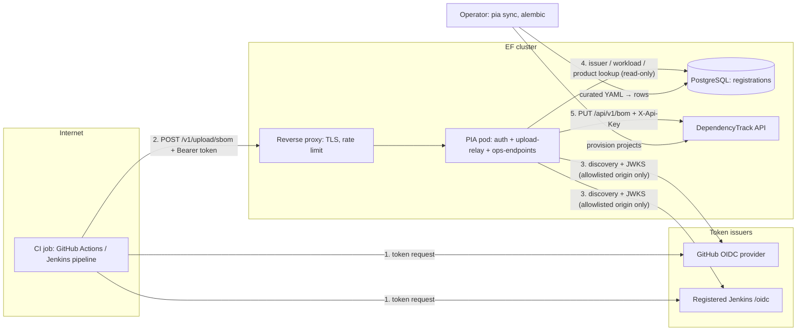

# Threat model — PIA (Project Identity Authority)

## 1.1 Header

- **Project**: PIA, the Eclipse Foundation's OIDC authentication broker for
  SBOM uploads to DependencyTrack. Repository `eclipse-csi/pia`.
- **Version binding**: release 0.9.0, modeled at commit `972572b` on `main`
  (the two commits after the `v0.9.0` tag change CI configuration only). A
  report against version *N* is triaged against the model as it stood at *N*,
  not HEAD. The 2026-11-11 revision adds the untrusted input sanitization
  that lands in the same pull request (CHANGELOG `[Unreleased]`); the commit
  binding moves to that code commit once its hash is final on `main`
  *(maintainer, 2026-11)*.
- **Date / author**: 2026-11-09, drafted by the maintainer with AI assistance;
  revised 2026-11-11 for untrusted input sanitization.
- **Generation metadata**: Claude Fable 5.1 (`claude-fable-5-1`), medium
  effort, driven by the `threat-model` plugin (orchestrator plus the recon,
  surface, interview, authoring, backtest and sidecar skills), the GitHub REST
  API for issue and advisory history, and the plugin's validator harness.
  The 2026-11-11 revision was produced by Claude Opus 5.5
  (`claude-opus-5-5`), driven by the same plugin (orchestrator, one
  interview wave, backtest of the new items; sidecars regenerated by hand
  and checked with the validator harness).
- **Reporting cross-reference**: §1.11 (claimed-property) findings go to the
  repository's private vulnerability reporting (GitHub security advisories);
  §1.3 / §1.12 findings are closed by citing this document.
- **Status**: accepted, 2026-11. All three question waves (two for 0.9.0,
  one for the sanitization revision) were answered by the maintainers in
  2026-11; every claim carries **documented** or **maintainer**
  provenance. Should a later revision reintroduce unratified claims, a disposition that closes a report
  against the reporter must be licensed by a **documented** or **maintainer**
  claim (§1.17); an **inferred** claim escalates instead, and an **assumption**
  closes only what the triage policy allows.
- **Triage policy**: `strict`. An **assumption** escalates like an **inferred**
  claim; nothing closes on an unratified claim.
- **Provenance legend**: *(documented, source)* = stated in the named public
  source; *(maintainer, YYYY-MM)* = confirmed by a maintainer in answer to
  this process; *(assumption, QN)* = a conservative default pending question
  `QN`; *(inferred, QN)* = reasoned from code, open, question `QN`.
- **Draft confidence**: 172 documented / 31 maintainer / 0 inferred / 0 assumption.
- **Backtest note**: routed a 49-item corpus in 28 clusters over all four
  in-scope components and all 8 contract dimensions; 24 items carry a real
  historical outcome (12 repository advisories, 5 published and 7 closed with
  a maintainer ruling, 3 of them duplicates; 5 fixes without an advisory; 5
  maintainer statements on issues, pull requests or advisory threads; 2
  scanner reports of an HTTP 500 on NUL or lone-surrogate text, fixed by the
  sanitization revision), 25 are synthesized. Dispositions: 20 `VALID` (6
  correctness-only), 0 `VALID-HARDENING`, 14 `BY-DESIGN:
  property-disclaimed`, 5 `KNOWN-NON-FINDING`, 10 `OUT-OF-MODEL`, 0
  `MODEL-GAP`. Fail-safe figure: all 17 historically-fixed items routed
  `VALID`. 29 of 49 close outright and none escalate. Two routings were revised against closed-advisory rulings:
  post-authentication log injection is correctness-only (`P-LOG-ESCAPE`
  split by tier), and repository-name recycling routes
  `OUT-OF-MODEL: adversary-not-in-scope` (project insider, §1.10).
- **Sibling models**: none. The Helm chart, the reverse proxy, and the
  `upload-sbom` GitHub Action live in other repositories and are out of scope
  here (§1.3).

PIA is a small network service. A CI job (a GitHub Actions workflow or a Jenkins
pipeline) sends it an SBOM together with a short-lived OpenID Connect (OIDC)
token. PIA checks the token against the token issuer's published keys, looks up
which Eclipse Foundation (EF) project the CI job is registered under, and
forwards the SBOM to the matching DependencyTrack project with PIA's own API
key. Registrations live in a PostgreSQL database that operators manage with the
`pia sync` CLI from a curated YAML file.

**At a glance.** The sections below carry the details and provenance; this
is the one-screen version.

- *PIA guarantees*: it talks only to allowlisted issuer origins and never
  follows their redirects (`P-ISSUER-PIN`); it accepts only RS256 tokens
  that verify against that issuer's keys with the right audience and lifetime
  (`P-SIG`); an upload lands only in a DependencyTrack project of the same EF
  project as the verified workload, and GitHub runs must be maintainer
  events (`P-WORKLOAD-BIND`); a slow issuer or DependencyTrack holds one
  worker, not the service (`P-NO-STALL`); issuer responses are capped
  (`P-ISSUER-BOUND`); unauthenticated input cannot forge log lines or mint
  metric series (`P-LOG-ESCAPE`, `P-METRIC-CARD`).
- *PIA does not provide*: replay protection (`D-REPLAY`), a total time bound
  against a trickling registered issuer (`D-SLOW-RETRIEVAL`), rate limiting
  or body caps (`D-RATE-LIMIT`, `D-SBOM-VALIDATION`), per-product least
  privilege inside an EF project (`D-PRODUCT-LEAST-PRIV`), any check on what
  a CI run did beyond its event name (`D-EVENT-SEMANTICS`, `D-JENKINS-JOB`),
  defence against a compromised issuer signing for its own workloads
  (`D-ISSUER-TRUST-ROOT`), or TLS on its own socket (`D-INBOUND-TLS`).
- *Operators own*: the reverse proxy (TLS, rate limit, body cap), a private
  `/metrics`, HTTPS to DependencyTrack and TLS to the database, a scoped
  DependencyTrack key, and the curated registration file (§1.13).
- *Publishers own*: keeping publishing workflows free of untrusted code,
  treating the ID token as a credential, and polling rather than retrying
  (§1.13).

**Glossary.** *Sink*: the exact parameter a finding is reported against.
*Disposition*: the one bucket a finding lands in (§1.17). *Disclaimed
property*: something PIA openly does not promise. *Trusted input*: a value
PIA takes at face value because its author is trusted. *Escalate*: hand to a
maintainer instead of closing.

> **Triager quick-start.** Given an inbound finding:
> 0. Read the triage policy above (`strict`); it decides what an
>    **assumption** may do in step 8.
> 1. Find the sink's row in the §1.7 trust table (or the §1.8 output row).
> 2. Find the contract dimension (numeric limits, failure atomicity,
>    topology, callback or collaborator execution, serialization, lifecycle,
>    concurrency, resource complexity) and follow the §1.7 matrix row to its
>    owning claim.
> 3. Check attacker capability and control kind against §1.7 and §1.10.
> 4. Check the component against §1.2 / §1.3 and any configuration against
>    §1.6. If the root cause is in a dependency, apply §1.9.
> 5. Apply the §1.17 precedence order, starting with an exact §1.15 match,
>    and assign exactly one disposition citing its section. If none fits,
>    assign `MODEL-GAP` and trigger §1.16.
> 6. **Before closing** (`OUT-OF-MODEL: *`, `BY-DESIGN: *`,
>    `KNOWN-NON-FINDING`), check the licensing claim's provenance:
>    **documented** or **maintainer** closes; **inferred** escalates;
>    **assumption** escalates under `strict`, and under `relaxed` may only
>    provisionally close a low-blast-radius route; a disclaimer resting on
>    silence never closes a security-critical report. Record `closed`,
>    `provisional`, or `escalated`; an escalated finding is not a
>    `MODEL-GAP`.

## 1.2 Scope and intended use

PIA's one intended use is to let EF build infrastructure publish SBOMs to the
EF DependencyTrack instance without long-lived shared secrets *(documented,
DESIGN.md §1.1 and §1.3)*. It runs as a container on Kubernetes behind a
reverse proxy that terminates TLS and rate-limits *(documented, DESIGN.md
§8.1)*, one uvicorn worker per pod, scaled by pods *(documented, DESIGN.md
§5.4 "Single worker")*. The modeled deployment baseline is exactly that: a
proxy in front, `/metrics` not routed publicly, a read-only database user for
the app, and operators running the CLI and migrations out of band
*(maintainer, 2026-11)*.

Roles, as a network service: the *client* is a CI job presenting a token
(untrusted until verified); the *operator* is EF staff who curate
registrations, hold the secrets, and deploy (trusted); the *peers* are the
token issuers and DependencyTrack (authenticated collaborators, see §1.10).

| Component family | Representative entry point | Touches outside the process? | In model? | Provenance |
| --- | --- | --- | --- | --- |
| `auth` — bearer parsing, issuer allowlist, OIDC discovery and JWKS fetch, signature and claim verification, workload matching (`pia/main.py` `authenticate`, `pia/oidc.py`, matching helpers in `pia/models.py`) | `POST /v1/upload/sbom`, `Authorization` header | yes: HTTPS to the token issuer, PostgreSQL reads | in | *(documented, DESIGN.md §3.1.1)* |
| `upload-relay` — DependencyTrack project resolution and SBOM relay (`pia/main.py` `upload_sbom`, `pia/dependencytrack.py`) | `POST /v1/upload/sbom` body | yes: HTTPS to DependencyTrack, PostgreSQL reads | in | *(documented, DESIGN.md §3.1 steps 5–6)* |
| `ops-endpoints` — liveness, Prometheus metrics, request-ID and metrics middleware (`pia/main.py`, `pia/metrics.py`) | `GET /livez`, `GET /metrics`, every request | no (serves process memory) | in | *(documented, DESIGN.md §4.1)* |
| `operator-tooling` — `pia sync`, `pia create-dt-projects` (`pia/cli.py`, `pia/sync.py`) and the Alembic migrations (`alembic/`) | `pia sync FILE`, `alembic upgrade head` | yes: reads the curated file and `PIA_*` env, HTTPS to GitHub and DependencyTrack, PostgreSQL writes | in, at operator trust (§1.7) | *(documented, DESIGN.md §5.5 and README "Database Migration")* |
| `dev-bootstrap-script` — `scripts/dt_bootstrap.py` | `uv run python scripts/dt_bootstrap.py` | yes (local HTTP) | out (§1.3) | *(documented, `scripts/dt_bootstrap.py` docstring "Targets the local docker-compose DependencyTrack only")* |
| `dev-compose-stack` — `docker-compose.yml`, `projects.local.yaml` | `docker compose up` | yes | out (§1.3) | *(documented, docker-compose.yml "Dev-only convenience" comment)* |
| `tests` — `tests/` | `pytest` | no | out (§1.3) | *(documented, README "Running Tests")* |

## 1.3 Out of scope (explicit non-goals)

- **Not a general OIDC relying party.** Only GitHub's issuer and registered
  `https://ci.eclipse.org/<name>/oidc` Jenkins issuers, only RS256
  *(documented, DESIGN.md §3.1.1 steps 2 and 4 "Verify signature using
  RSA256")*. Other issuers, algorithms, or token formats are unsupported
  inputs, not bugs.
- **DependencyTrack's own access control.** DependencyTrack trusts PIA's API
  key wholesale; limiting the key is the operator's job *(documented,
  DESIGN.md §2.2 item 3; `pia/cli.py` module docstring)*.
- **The trust root.** A registered issuer signing for its own workloads is
  believed; PIA cannot detect a compromised GitHub OIDC provider or Jenkins
  controller *(documented, DESIGN.md §2.2 items 1–2)*. What PIA does bound
  about an issuer is `P-ISSUER-PIN` and `P-ISSUER-BOUND` (§1.11).
- **Inbound TLS and rate limiting.** PIA listens on plain HTTP (`Dockerfile`
  `CMD`); both belong to the reverse proxy *(documented, DESIGN.md §8.1 and
  §8.3)*.
- **Per-product least privilege.** The EF project is the authorization
  boundary: any registered workload of a project may publish to any of its
  products *(documented, README "Authorization is scoped to the Eclipse
  Foundation project")*.
- **The CI side.** PIA checks the GitHub `event_name` and nothing else about
  what a run did *(documented, DESIGN.md §3.1.1 step 6)*.
- **Insiders of a registered project.** Repository registrations scope which
  pipelines publish; they are not a boundary between members of one
  organization. The owner's immutable id is pinned so an *outsider* cannot
  re-register a deleted or renamed organization; reusing a repository name
  inside the organization needs a position inside the project's trust domain
  *(maintainer, 2026-10)*.
- **Host and cluster compromise.** Whoever reads the pod's environment holds
  the API key and database credentials *(documented, DESIGN.md §8.2 required
  environment variables)*; that attacker is out of scope *(maintainer,
  2026-11)*.
- **Shipped-but-unsupported code.** `scripts/dt_bootstrap.py` is local-dev
  only *(documented, `scripts/dt_bootstrap.py` docstring)*; `docker-compose.yml`
  is dev-only *(documented, docker-compose.yml comments)*; `tests/` and
  `projects.local.yaml` are not in the image *(documented, Dockerfile `COPY`
  lines)*. Findings there route `OUT-OF-MODEL: unsupported-component`.
- **Separate repositories.** The Helm chart, the `upload-sbom` Action, and
  the proxy configuration are not modeled here *(documented, README "Database
  Migration" and `.github/workflows/sbom.yml`)*.

## 1.4 Trust boundaries and data flow

The request crosses the boundary unauthenticated and nothing in it is trusted
until the signature check passes *(documented, DESIGN.md §3.1.1 steps 1–4)*.
Before that check, the issuer allowlist alone decides where PIA's two outbound
fetches go *(documented, `pia/main.py` `authenticate` comment "Pre-verification
check")*. After it, verified claims pick the workload and its EF project, the
body's `product_name` picks a target inside that project only, and the payload
goes to DependencyTrack unchanged under PIA's own key *(documented, DESIGN.md
§3.1 steps 5–6)*. Operators write registrations out of band from the curated
file *(documented, DESIGN.md §5.5)*.

Reachability preconditions:

- `auth`: a finding matters if it is reachable from the `Authorization`
  header of an unauthenticated request, or from an allowlisted issuer's HTTP
  response *(documented, DESIGN.md §3.1.1)*.
- `upload-relay`: reachable from the body of a request whose token verified
  for a registered workload, or from a DependencyTrack response *(documented,
  DESIGN.md §3.1 steps 5–6)*.
- `ops-endpoints`: reachable from any HTTP request to the pod, including
  unmatched routes and unknown methods *(documented, DESIGN.md §5.4 "Label
  cardinality")*.
- `operator-tooling`: reachable from the curated file, the `PIA_*`
  environment, or a GitHub / DependencyTrack API response; all are operator
  trust *(documented, DESIGN.md §5.5 "human-curated file")*.

## 1.5 Assumptions about the environment

- **Runtime**: Python ≥ 3.13.2 on `python:3.14-slim` as a non-root user, one
  uvicorn worker per container, stateless across pods with the database as the
  only shared state *(documented, DESIGN.md §5.4 "Single worker" and §8.3)*.
- **Concurrency**: `authenticate` and `upload_sbom` are plain `def`, so
  blocking I/O holds one threadpool worker, not the event loop *(documented,
  `pia/main.py` comment above `authenticate`)*; metrics live in a
  process-global registry *(documented, `pia/metrics.py` module docstring)*.
- **Clock and network**: `exp` / `iat` are checked against the pod clock with
  no leeway *(documented, DESIGN.md §3.1.1 step 4)*; outbound HTTPS goes to
  the allowlisted issuers and DependencyTrack, the CLI also to
  `api.github.com` *(documented, `pia/sync.py` `fetch_github_owner_id`
  docstring)*; the app's database user needs read access only *(documented,
  README "Database Migration")*.

No-surprise side-effects inventory, from a scan of every file the image ships
(`pia/*.py`, `alembic/env.py`; command:
`grep -rn 'subprocess\|os\.system\|signal\.\|socket\.\|tempfile\|threading\|pickle\|yaml\.load\|eval(\|exec(\|os\.environ\|getenv\|open(' pia/ alembic/env.py`
— 7 hits, all `os.environ` reads of `PIA_*` in `pia/cli.py` and
`alembic/env.py`, plus the one `open()` of the curated file in `pia/sync.py`):

- PIA spawns no child processes, installs no signal handlers, and writes no
  files *(maintainer, 2026-11)*.
- PIA's own code reads only `PIA_*` environment variables (`pia/config.py`
  `env_prefix="PIA_"`, `pia/cli.py`, `alembic/env.py`) *(maintainer, 2026-11)*.
- The only sockets PIA's own code opens are HTTPS to the allowlisted issuer,
  the configured DependencyTrack URL, `api.github.com` (CLI only), and the
  database *(maintainer, 2026-11)*.
- Process-wide mutation is limited to import time in `pia/main.py`: the
  logging record factory and `basicConfig`, the `Settings()` load, and the
  Prometheus default registry *(maintainer, 2026-11)*.
- The scan does not cover dependencies: the `requests` library reads
  `HTTP_PROXY` / `HTTPS_PROXY` / `NO_PROXY`, `REQUESTS_CA_BUNDLE` /
  `CURL_CA_BUNDLE`, and `~/.netrc` on PIA's behalf. The production image ships
  none of these, so a report that needs one of them set requires control of
  the pod and routes `OUT-OF-MODEL: adversary-not-in-scope` *(maintainer, 2026-11)*.
- Logging goes to stdout/stderr at INFO with a plaintext single-line format;
  the bearer token and the API key are never logged *(maintainer, 2026-11)*.

## 1.6 Build-time and configuration variants

There are no compile-time flags. Runtime knobs that change the security
envelope:

| Knob | Default | Effect on the model | Support posture | Provenance |
| --- | --- | --- | --- | --- |
| `PIA_EXPECTED_AUDIENCE` | `pia.eclipse.org` | The `aud` value every token must carry; one value per deployment prevents cross-service replay of the same token. | supported; set per deployment | *(documented, DESIGN.md §4.2 and §7.2 "Set audience, to prevent cross-service token replay")* |
| `PIA_DEPENDENCY_TRACK_URL` with an `http://` scheme | `https://sbom.eclipse.org/api/v1/bom` | Sends the API key and every SBOM in cleartext; voids `P-OUTBOUND-TLS`. | dev-only (compose stack); production must use HTTPS | *(maintainer, 2026-11)* |
| `PIA_DATABASE_URL` without `sslmode` | none (required) | Database traffic, including registration reads and CLI writes, may travel in cleartext. PIA makes no claim either way (`D-DB-TRANSPORT`). | operator decision | *(maintainer, 2026-11)* |
| uvicorn `--workers N>1` | 1 | Each worker keeps its own metrics registry; `/metrics` becomes wrong. | unsupported (needs multiprocess mode) | *(documented, DESIGN.md §5.4 "Single worker")* |
| uvicorn `--reload`, migrations on app start | off | Dev conveniences in `docker-compose.yml`. | dev-only | *(documented, docker-compose.yml comments)* |
| `pia sync --allow-db-updates-and-deletions` | off | Without it, `pia sync` refuses a plan that deletes or changes existing rows, so a bad file cannot silently deauthorize a project. | supported; explicit intent required | *(documented, `pia/cli.py` option help "Explicit intent is required")* |
| `GITHUB_ALLOWED_EVENT_NAMES`, `JENKINS_ISSUER_BASE_URL` | `{push, workflow_dispatch, release, schedule}`, `https://ci.eclipse.org` | Code constants, not configuration. Changing either is a model change (§1.16). | n/a | *(documented, `pia/models.py` constant docstrings)* |

No shipped default voids a §1.11 property. Rows written to the database by
anything other than `pia sync` are unsupported: the ORM comment states that the
constraints alone do not keep a row coherent and that `pia sync` guarantees
coherency *(documented, `pia/models.py` `DependencyTrackProject` comment "pia
sync guarantees coherency")*; such rows route `OUT-OF-MODEL: non-default-build`.

## 1.7 Assumptions about inputs

Every HTTP route (3 of 3), both CLI subcommands (2 of 2) and the migration
entry point have rows below; the table is complete for the modeled version.
Size assumptions: PIA buffers the whole request body in memory and never
streams it; the SBOM is a base64 string it does not decode *(documented, issue
#111 "nothing is streamed")*. Issuer responses are capped at 1 MiB each
*(documented, DESIGN.md §3.1.1 step 3)*.

| Entry point | Input operand | Attacker-controllable? | Control kind | Caller must enforce | Provenance |
| --- | --- | --- | --- | --- | --- |
| `POST /v1/upload/sbom` | `Authorization` header (`Bearer <JWT>`) | yes, by anyone who can reach the proxy | data, serialized-state | none — `P-SIG` | *(documented, DESIGN.md §4.1 request headers)* |
| `POST /v1/upload/sbom` | unverified JWT `iss` claim (selects the discovery URL) | yes | resource-name | must be a printable string before the database lookup, else 401 — `P-ERRORS`; `P-ISSUER-PIN` | *(documented, DESIGN.md §3.1.1 step 2)* *(documented, CHANGELOG `[Unreleased]` "untrusted input sanitization")* |
| `POST /v1/upload/sbom` | JWT header `kid`, `alg` | yes | data, type-class | none — `P-SIG` (RS256 only, `kid` must match a `sig` key) | *(documented, DESIGN.md §3.1.1 step 4 "Verify signature using RSA256")* |
| `POST /v1/upload/sbom` | verified claims `aud`, `exp`, `iat`, `repository`, `repository_owner_id`, `event_name` | conditional: only a registered issuer can sign them; the triggering actor chooses `event_name`, `ref` and similar within what the issuer allows | data | `repository` and `repository_owner_id` must be printable strings before the lookup — `P-SIG`, `P-WORKLOAD-BIND`, `P-ERRORS` | *(documented, DESIGN.md §3.1.1 steps 5–6)* *(documented, CHANGELOG `[Unreleased]` "untrusted input sanitization")* |
| `POST /v1/upload/sbom` | body `product_name` | yes (authenticated workload) | resource-name | strict non-empty printable string, else 422 — `P-ERRORS`; so a registered name matches only if it is printable (`register-printable-names`, §1.13); `P-WORKLOAD-BIND` resolves it only within the workload's EF project | *(documented, README authorization note)* *(documented, CHANGELOG `[Unreleased]` "untrusted input sanitization")* *(maintainer, 2026-11)* |
| `POST /v1/upload/sbom` | body `product_version`, `is_latest` | yes (authenticated workload) | data | strict types (non-empty printable string, boolean), else 422 — `P-ERRORS`; DependencyTrack validates; PIA relays verbatim (`D-SBOM-VALIDATION`) | *(documented, DESIGN.md §3.1 step 6)* *(documented, CHANGELOG `[Unreleased]` "untrusted input sanitization")* |
| `POST /v1/upload/sbom` | body `bom` (base64 CycloneDX) | yes (authenticated workload) | data, size | proxy caps the body size; DependencyTrack validates content (`D-SBOM-VALIDATION`) | *(documented, DESIGN.md §3.1 step 3 "so that we don't have to parse the SBOM")* |
| `POST /v1/upload/sbom` | `Content-Type`, malformed or non-UTF-8 body | yes | data, type-class | none — `P-ERRORS` | *(documented, CHANGELOG 0.9.0 "#110")* |
| `POST /v1/upload/sbom` | OIDC discovery document (`jwks_uri` and the rest) | conditional: only the allowlisted issuer's origin can answer | data, size, resource-name | none — `P-ISSUER-PIN`, `P-ISSUER-BOUND` | *(documented, DESIGN.md §3.1.1 step 3)* |
| `POST /v1/upload/sbom` | JWKS document | conditional: only a path under the issuer URL | data, size, serialized-state (key material) | none — `P-ISSUER-BOUND`; keys are only ever used to *verify* | *(documented, DESIGN.md §3.1.1 step 3)* |
| `POST /v1/upload/sbom` | DependencyTrack response (status, body, `token`) | conditional: DependencyTrack only, a trusted collaborator | data | relayed verbatim to the client (§1.8, `D-DT-RESPONSE`) | *(documented, DESIGN.md §4.1 "Relay DependencyTrack status code and body verbatim")* |
| any route | HTTP method, path, `X-Request-ID` header | yes | data | none — `P-METRIC-CARD`; inbound request IDs are ignored | *(documented, DESIGN.md §5.4 "Label cardinality"; `pia/main.py` `assign_request_id` docstring)* |
| `GET /livez`, `GET /metrics` | none (query and headers ignored) | yes, but unused | data | nothing | *(documented, DESIGN.md §4.1)* |
| `pia sync FILE`, `pia create-dt-projects FILE` | curated YAML file | no — operator-authored, the authorization policy itself | data, serialized-state, resource-name | keep it correct and canonical (`curate-authorization-file`, §1.13) | *(documented, DESIGN.md §5.5 "curated projects file")* |
| `pia sync`, `pia create-dt-projects` | `PIA_DATABASE_URL`, `PIA_DEPENDENCY_TRACK_API_KEY`, `PIA_GITHUB_TOKEN`, `--dt-url` | no — operator environment | data, resource-name | keep secrets out of logs and shell history | *(documented, `pia/cli.py` module docstring)* |
| `pia sync`, `pia create-dt-projects` | GitHub `GET /users/{owner}` and DependencyTrack project API responses | conditional: those services only | data | treated as trusted collaborator output (§1.10) | *(documented, `pia/sync.py` `build_desired` docstring)* |
| `alembic upgrade head` | `PIA_DATABASE_URL`; shipped migration scripts | no — operator environment and shipped code | data, resource-name | run with migration credentials, before rollout | *(documented, README "Database Migration")* |
| app start | `PIA_*` settings | no — operator environment | data, resource-name | §1.6 | *(documented, DESIGN.md §4.2)* |

Contract-dimension matrix (every required dimension once per in-scope
component):

| Component | Dimension | Status | Conditions / boundary | Routes to | Provenance |
| --- | --- | --- | --- | --- | --- |
| `auth` | numeric domain | claimed | issuer responses ≤ 1 MiB decoded; `exp`/`iat` are checked as numbers by PyJWT; `iss` must be a printable string before the database lookup | §1.11 `P-ISSUER-BOUND`, `P-ERRORS` | *(documented, DESIGN.md §3.1.1 step 3; CHANGELOG 0.9.0 "#109")* *(documented, CHANGELOG `[Unreleased]` "untrusted input sanitization")* |
| `auth` | failure atomicity | N/A — no state is mutated; every request is independent and the database is read-only for the app | — | §1.5 | *(documented, README "runtime database user only needs read access")* |
| `auth` | recursive/cyclic topology | N/A — inputs are flat JSON documents (JWT payload, discovery, JWKS); nesting depth is the runtime JSON parser's contract | — | §1.9 | *(documented, DESIGN.md §5.1 PyJWT entry)* |
| `auth` | callback/collaborator execution | claimed | the only collaborator whose output steers execution is the issuer; PIA follows its `jwks_uri` only under the issuer URL and follows no redirects | §1.11 `P-ISSUER-PIN` | *(documented, CHANGELOG 0.9.0 "#113")* |
| `auth` | serialization/reconstruction | claimed | JWT and JWKS are parsed by PyJWT as JSON; keys are reconstructed as RSA public keys and used only to verify RS256 | §1.11 `P-SIG` | *(documented, DESIGN.md §3.1.1 step 4)* |
| `auth` | reference lifecycle | disclaimed | a token is accepted any number of times until `exp`; no `jti` tracking | §1.12 `D-REPLAY` | *(documented, DESIGN.md §10 "Protect against replayed tokens")* |
| `auth` | concurrency/reentrancy | claimed | a slow issuer holds one threadpool worker; about 40 concurrent slow requests exhaust the pool | §1.11 `P-NO-STALL` | *(documented, PR #112 description "About 40 such requests")* |
| `auth` | resource complexity | disclaimed | per request: up to two outbound fetches, each 10 s per read and 1 MiB; no cap on request volume and no bound on total time against a trickling issuer | §1.12 `D-RATE-LIMIT`, `D-SLOW-RETRIEVAL` | *(documented, DESIGN.md §8.3 rate limiting at the reverse proxy; §10 slow retrieval)* |
| `upload-relay` | numeric domain | disclaimed | no length cap on `bom`, `product_name` or `product_version`; the binding limits are DependencyTrack's 20,000,000-character cap and the proxy's body limit; the two name fields must only be non-empty and printable | §1.12 `D-SBOM-VALIDATION` | *(documented, issue #111 "The binding limit today is DT's")* *(maintainer, 2026-11)* |
| `upload-relay` | failure atomicity | disclaimed | a 500 or 502 does not mean the SBOM was not stored; retry may duplicate it | §1.12 `D-EXTERNAL-ATOMICITY` | *(documented, `pia/main.py` `upload_sbom` comment "a retry is NOT safe")* |
| `upload-relay` | recursive/cyclic topology | N/A — the body schema is four flat fields; the SBOM is an opaque string | — | §1.11 `P-SBOM-OPAQUE` | *(documented, DESIGN.md §4.1 request body)* |
| `upload-relay` | callback/collaborator execution | disclaimed | DependencyTrack's response is relayed verbatim; PIA does not sanitize it | §1.12 `D-DT-RESPONSE` | *(documented, DESIGN.md §4.1 "verbatim")* |
| `upload-relay` | serialization/reconstruction | claimed | the SBOM is never decoded or parsed by PIA | §1.11 `P-SBOM-OPAQUE` | *(documented, DESIGN.md §3.1 step 3)* |
| `upload-relay` | reference lifecycle | claimed | the target project is resolved per request from the database; a `pia sync` change applies to the next request | §1.11 `P-WORKLOAD-BIND` | *(documented, DESIGN.md §3.1 step 5)* |
| `upload-relay` | concurrency/reentrancy | claimed | the DependencyTrack call has connect/read timeouts and runs in the threadpool | §1.11 `P-NO-STALL` | *(documented, `pia/dependencytrack.py` `TIMEOUT` docstring)* |
| `upload-relay` | resource complexity | disclaimed | the whole body, its parse, and the base64 string sit in memory at once | §1.12 `D-SBOM-VALIDATION` | *(documented, issue #111 "Memory in PIA")* |
| `ops-endpoints` | numeric domain | claimed | every label value comes from a fixed set, a route template, or a database row | §1.11 `P-METRIC-CARD` | *(documented, DESIGN.md §5.4 "Label cardinality")* |
| `ops-endpoints` | failure atomicity | N/A — counters only increment; no transactional state | — | §1.5 | *(documented, `pia/metrics.py` module docstring)* |
| `ops-endpoints` | recursive/cyclic topology | N/A — no structured input | — | §1.7 | *(documented, DESIGN.md §4.1)* |
| `ops-endpoints` | callback/collaborator execution | N/A — no collaborator; `/livez` is static and `/metrics` reads process memory | — | §1.12 `D-LIVEZ-STATIC` | *(documented, `pia/main.py` `livez` docstring)* |
| `ops-endpoints` | serialization/reconstruction | N/A — output only (text exposition) | — | §1.8 | *(documented, DESIGN.md §4.1)* |
| `ops-endpoints` | reference lifecycle | claimed | one request ID per request, generated server-side, reset after the request | §1.11 `P-LOG-ESCAPE` | *(documented, `pia/main.py` `assign_request_id` docstring)* |
| `ops-endpoints` | concurrency/reentrancy | claimed | handlers are `async` and do no blocking I/O, so they answer while the threadpool is busy | §1.11 `P-NO-STALL` | *(documented, CHANGELOG 0.9.0 "no longer stalls all other requests")* |
| `ops-endpoints` | resource complexity | claimed | registry size is bounded by label cardinality; `/metrics` is unauthenticated but not routed publicly | §1.11 `P-METRIC-CARD`; §1.12 `D-METRICS-AUTH` | *(documented, DESIGN.md §4.1 and §5.4)* |
| `operator-tooling` | numeric domain | disclaimed | no limits on file size, project count, or API response size | §1.12 `D-CLI-BOUNDS` | *(documented, DESIGN.md §5.5 states no limits)* |
| `operator-tooling` | failure atomicity | claimed | `pia sync` applies its plan in one transaction and commits at the end; `create-dt-projects` is idempotent but not atomic | §1.11 `P-SYNC-ATOMIC`; §1.12 `D-EXTERNAL-ATOMICITY` | *(documented, `pia/sync.py` `apply_plan` docstring; `pia/cli.py` `create_dt_projects` help "Idempotent")* |
| `operator-tooling` | recursive/cyclic topology | N/A — the file schema is two levels deep with `extra="forbid"` | — | §1.7 | *(documented, `pia/sync.py` module docstring file example)* |
| `operator-tooling` | callback/collaborator execution | N/A — GitHub and DependencyTrack are trusted collaborators whose answers (owner ids, UUIDs) are taken as true | — | §1.10 | *(documented, `pia/sync.py` `build_desired` docstring)* |
| `operator-tooling` | serialization/reconstruction | N/A — the file is operator-trusted and loaded with `yaml.safe_load`, which constructs no arbitrary objects | — | §1.7 | *(documented, DESIGN.md §5.5 "curated")* |
| `operator-tooling` | reference lifecycle | claimed | rows are keyed by their business columns; a changed row is a delete plus a create | §1.11 `P-SYNC-ATOMIC` | *(documented, `pia/sync.py` `compute_plan` docstring)* |
| `operator-tooling` | concurrency/reentrancy | disclaimed | no lock between concurrent `pia sync` runs | §1.12 `D-CLI-BOUNDS` | *(documented, DESIGN.md §5.5 makes no concurrency statement)* |
| `operator-tooling` | resource complexity | disclaimed | GitHub and DependencyTrack calls carry no timeout; interactive use | §1.12 `D-CLI-BOUNDS` | *(documented, DESIGN.md §5.5 makes no resource statement)* |

Failure postconditions: the service mutates no state, so none apply to `auth`
or `ops-endpoints`. For `upload-relay`, the DependencyTrack write may have
happened when PIA returns 500 (`D-EXTERNAL-ATOMICITY`). For `pia sync`, a
failure before `session.commit()` leaves the database unchanged
(`P-SYNC-ATOMIC`).

## 1.8 Assumptions and guarantees about outputs

| Output channel | Component | Taint | Downstream must not assume | Provenance |
| --- | --- | --- | --- | --- |
| DependencyTrack upload request (`projectName`, `projectVersion`, `isLatest`, `bom`, plus `parentUUID` from the database and `autoCreate: true`) | `upload-relay` | Exactly as untrusted as the client's payload; no sanitization, normalization, or decoding is performed | That the SBOM is well-formed CycloneDX, that the version string is sane, or that the name was vetted beyond matching a registered product | *(documented, DESIGN.md §3.1 step 6)* |
| HTTP 200 body `polling_url` | `upload-relay` | **Assembled**: configured DependencyTrack URL + the `token` DependencyTrack returned | That the URL is reachable from outside the cluster | *(documented, issue #66 "polling_url should be externally reachable")* |
| Relayed DependencyTrack error (status and body, as `application/json`) | `upload-relay` | Exactly as untrusted as DependencyTrack's answer; passed through verbatim | That the body is JSON, or free of content echoed from the SBOM | *(documented, DESIGN.md §4.1 "Relay DependencyTrack status code and body verbatim")* |
| HTTP 401 / 422 / 502 / 500 bodies | `auth`, `upload-relay` | Constant strings, except the `claims_rejected` 401 which embeds the rejected `event_name` value (issuer-signed, chosen by the triggering actor) | That a 401 distinguishes "unknown issuer" from "unregistered workload" beyond the stated reason strings; or that it hides whether a Jenkins issuer URL is registered (`D-ISSUER-ENUMERATION`) | *(documented, DESIGN.md §4.1 response list; PR #99 description "nothing to withhold")* |
| `X-Request-ID` response header | `ops-endpoints` | Server-generated 16 hex characters; never taken from the request | Correlation with an inbound header | *(documented, `pia/main.py` `assign_request_id` docstring)* |
| Log lines (stdout) | all service components | **Assembled**: caller-influenced values (`iss`, allowlisted claims, `product_name`, `product_version`, DependencyTrack body up to 500 bytes) are ASCII-escaped with `!a`; the bearer token and API key never appear | That a log line is free of attacker-chosen text; it is escaped, not absent. The `actor` claim is deliberately not logged | *(documented, `pia/main.py` `LOGGED_CLAIMS` and `_claims_summary` docstrings)* |
| `GET /metrics` text exposition | `ops-endpoints` | Label values are fixed sets, route templates, or database rows (`ef_project_id`, `product_name`); never raw request input | That the endpoint is private unless the ingress keeps it so | *(documented, DESIGN.md §5.4 and §4.1)* |
| CLI stdout (plan) | `operator-tooling` | Row `__repr__` text built from the curated file and resolved ids | Nothing security-relevant; may contain owner ids and UUIDs | *(documented, `pia/sync.py` `format_plan` docstring)* |
| Database rows | `operator-tooling` | Written only by `pia sync` from the curated file plus GitHub owner ids and DependencyTrack UUIDs | That rows written any other way are coherent (§1.6) | *(documented, `pia/models.py` comment "the curated file is the only writer")* |

Structural invariants promoted to §1.11: the SBOM reaches DependencyTrack
byte-identical (`P-SBOM-OPAQUE`); no raw request value becomes a metric label
(`P-METRIC-CARD`); caller text in logs is escaped (`P-LOG-ESCAPE`).

## 1.9 Assumptions about dependencies

PIA has 13 direct runtime dependencies pinned in `uv.lock` and no vendored
third-party code *(documented, `pyproject.toml` `[project] dependencies`)*.
Routing rule: a dependency failing its own documented contract while PIA used
it conformantly is `OUT-OF-MODEL: dependency-contract`, forwarded upstream; PIA
misusing a dependency (as with the earlier `async def` around blocking calls,
or `PyJWKClient` without caps) is in-model.

| Dependency | Relied on for | Violation handled |
| --- | --- | --- |
| PyJWT + cryptography | RS256 verification, `exp`/`iat`/`aud` checks with `require`, JWKS parsing into verify-only keys *(documented, DESIGN.md §5.1 "PyJWT … Handles token parsing, validation, and signature verification")* | upstream |
| requests, urllib3, certifi | TLS certificate verification by default; `allow_redirects=False` honoured; `timeout` as a per-read gap; `read1` returning after one socket read *(documented, `pia/oidc.py` `_fetch_json` docstring)* | upstream |
| FastAPI, Starlette, pydantic | Body and header parsing, 422 generation, running `def` handlers in the threadpool, middleware order *(documented, DESIGN.md §5.1)* | upstream |
| uvicorn, h11 | HTTP/1.1 parsing, header and line limits, keep-alive; request-smuggling resistance *(documented, DESIGN.md §8.1 "Production ASGI server (e.g., uvicorn)")* | upstream |
| SQLAlchemy, psycopg | Parameterized queries, pooling with `pool_pre_ping` *(documented, CHANGELOG 0.6.0 "DB connection loss")* | upstream |
| Alembic | Migration execution under the migration credentials *(documented, README "Database Migration")* | upstream |
| pydantic-settings | `PIA_*` environment parsing *(documented, DESIGN.md §4.2)* | upstream |
| click, PyYAML, prometheus-client | CLI parsing; `safe_load`; registry and text exposition *(documented, DESIGN.md §5.1)* | upstream |

`requests` reads proxy, CA-bundle and `.netrc` settings from the host on PIA's
behalf; the production image sets none of them (§1.5) *(maintainer, 2026-11)*. External collaborators are not code
dependencies: a GitHub or Jenkins issuer that signs wrongly, or a
DependencyTrack that mis-stores an upload, is handled by §1.10 (trusted peer),
not by `dependency-contract`.

## 1.10 Adversary model

Actors assume the §1.2 baseline deployment.

| Actor | In scope? | Capabilities held | Capabilities excluded | Goals | Provenance |
| --- | --- | --- | --- | --- | --- |
| Unauthenticated network client | **yes** | Reach the upload endpoint through the proxy; send any header, any unsigned or self-signed JWT with any `iss`, any body; repeat at the proxy's rate limit | No signing key of a registered issuer; no control over a registered issuer, DependencyTrack, the database, or the pod environment; no position on PIA's outbound connections | SSRF from PIA's network position, service stall, auth bypass, log forgery, error-path crashes | *(maintainer, 2026-11)* |
| Non-maintainer contributor to a registered GitHub repository | **yes** | Open pull requests, comment, fork; cause `pull_request_target`, `workflow_run`, `issue_comment` runs that mint valid GitHub tokens for the repo | Cannot cause a `push`, `workflow_dispatch`, `release` or `schedule` run, and cannot author the workflow file such a run executes | Publish an SBOM as the project | *(documented, `pia/models.py` `GITHUB_ALLOWED_EVENT_NAMES` docstring "events that only a maintainer can cause")* |
| Registered workload (a maintainer-triggered workflow or any job on a registered Jenkins) | **yes** | Hold a valid token for its own identity; choose `product_name`, `product_version`, `is_latest`, `bom`; replay its token until `exp` | Cannot obtain a token for another repository or Jenkins instance; cannot change registrations | Write into another EF project's DependencyTrack project; feed DependencyTrack malformed content | *(documented, README authorization note; DESIGN.md §4.3 "Authorization Boundary")* |
| Registered issuer (GitHub's OIDC provider, or a registered Jenkins controller), compromised or merely slow | **yes**, for confinement claims only | Serve any discovery and JWKS content; sign tokens for its own workloads; trickle responses | Cannot steer PIA's fetches off its own origin and path; cannot make PIA buffer more than 1 MiB per response; cannot have its keys accepted for another issuer's workloads | Cross-issuer key substitution, SSRF pivot, worker exhaustion | *(documented, PR #113 description "one project's Jenkins instance cannot point PIA at another project's keys"; PR #112 description "Known limitation (accepted risk)")* |
| Project insider: a member of a registered GitHub owner with repository-creation rights, a committer, or EF staff | no | Create repositories under the registered owner, including re-creating a deleted or renamed one; trigger allowlisted publish events | — (inside the project's trust domain; registrations scope pipelines, not insiders) | — | *(maintainer, 2026-10)* |
| Operator (curated file, `PIA_*` secrets, deploy) | no | Everything | — (trusted wholesale) | — | *(documented, DESIGN.md §2.2 "managed by Eclipse Foundation")* |
| DependencyTrack and PostgreSQL | no, trusted collaborators | Answer PIA's requests with anything | — | — | *(documented, DESIGN.md §2.2 item 3)* |
| Network attacker between PIA and the issuer, DependencyTrack, or the database | no | — | — | — | *(maintainer, 2026-11)* |
| Host, pod, or cluster attacker | no | Read environment, memory, and the database connection | — | — | *(maintainer, 2026-11)* |

## 1.11 Security properties the project provides

- **`P-SIG` Token authenticity** (`auth`): a request is authenticated only if
  its token verifies, with RS256, against a key from the allowlisted issuer's
  JWKS whose `kid` matches and whose `use` is `sig` or absent, with `aud`
  equal to `PIA_EXPECTED_AUDIENCE`, an unexpired `exp`, and an `iat`. Keys are
  fetched per request, so rotation and revocation take effect at the next
  request. *Violation symptom*: `integrity-bypass`. *Tier*:
  security-critical. *Voided by*: nothing. Search:
  `grep -rn 'verify_signature\|algorithms=\|verify=' pia/` — 3 hits:
  `pia/oidc.py:177` and `pia/oidc.py:180` (the verifying decode) and
  `pia/main.py:271` (`verify_signature=False`), whose output only selects the
  issuer allowlist row and never reaches an authorization decision.
  *(documented, DESIGN.md §3.1.1 steps 3–4)*
- **`P-ISSUER-PIN` Outbound fetch confinement** (`auth`): the two
  pre-authentication fetches go only to an allowlisted issuer origin. The
  unverified `iss` must be a string equal to the GitHub issuer or a registered
  Jenkins issuer (`pia/models.py:268`, `pia/models.py:271`,
  `pia/models.py:279`); `jwks_uri` must start with `{iss}/` and continue with
  unreserved characters and no `.` or `..` segments (`pia/oidc.py:50`,
  `pia/oidc.py:54`, `pia/oidc.py:57`); redirects are refused and only HTTP 200
  is accepted (`pia/oidc.py:82`). *Violation symptom*:
  `x-outbound-request-to-unlisted-host` (SSRF). *Tier*: security-critical.
  *Voided by*: nothing at run time; registering an issuer is operator policy
  (§1.7). Search:
  `grep -rn 'allow_redirects\|is_issuer_known(\|_is_jwks_uri_allowed(' pia/`
  — 5 hits: two definitions and their three uses on the enforcing path.
  *(documented, DESIGN.md §3.1.1 steps 2–3; CHANGELOG 0.6.0 "#84" and 0.9.0
  "#113")*
- **`P-ISSUER-BOUND` Bounded issuer response consumption** (`auth`): each
  discovery and JWKS response is read in chunks under a 10 s connect/read
  timeout, capped at 1 MiB after decompression (`pia/oidc.py:92`), and
  abandoned once a 10 s deadline passes between reads (`pia/oidc.py:96`).
  Total wall time is not bounded (`D-SLOW-RETRIEVAL`). *Violation symptom*:
  `unbounded-allocation`. *Tier*: security-critical. *Voided by*: nothing.
  Search: `grep -rn 'MAX_RESPONSE_SIZE\|PyJWKClient' pia/` — hits only in
  `pia/oidc.py`, `PyJWKClient` only in comments. *(documented, DESIGN.md
  §3.1.1 step 3)*
- **`P-WORKLOAD-BIND` Project-scoped authorization** (`auth`,
  `upload-relay`): verified claims must match exactly one registered workload
  — GitHub by owner, repository name and `repository_owner_id`
  (`pia/models.py:312`, `pia/models.py:313`, `pia/models.py:314`), Jenkins by
  `iss` (`pia/models.py:320`); a GitHub `event_name` must be a string and one of `push`,
  `workflow_dispatch`, `release`, `schedule` (`pia/models.py:337`); the
  target is resolved by `product_name` only among projects with the
  workload's `ef_project_id` (`pia/models.py:351`); one identity maps to one
  EF project by uniqueness (`pia/models.py:152`, `pia/models.py:178`).
  *Violation symptom*: `integrity-bypass`. *Tier*: security-critical.
  *Voided by*: nothing at run time; the binding is as good as the registration
  (§1.7). Search:
  `grep -rn 'find_dt_project(\|find_workload_by_claims(\|verify_workload_claims(' pia/main.py`
  — one call each on the upload path. *(documented, README authorization
  note; DESIGN.md §3.1.1 steps 5–6 and §4.3)*
- **`P-NO-STALL` Availability isolation** (`auth`, `upload-relay`,
  `ops-endpoints`): a slow issuer or DependencyTrack holds one threadpool
  worker, never the event loop; the DependencyTrack call has 5 s connect and
  30 s read timeouts (`pia/dependencytrack.py:11`). Threshold: about 40
  concurrent slow requests exhaust the default pool. *Violation symptom*:
  `hang` of unrelated requests. *Tier*: security-critical. *Voided by*:
  nothing. Search: `grep -n 'async def' pia/main.py` — 7 hits: one comment and
  six definitions (`lifespan`, the validation handler, both middlewares,
  `livez`, `get_metrics`), none doing blocking I/O. *(documented, CHANGELOG
  0.9.0 "#112"; PR #112 description)*
- **`P-LOG-ESCAPE` Log integrity before authentication** (`auth`,
  `ops-endpoints`): values logged before the signature check — the unverified
  `iss` (`pia/main.py:286`) and decode or verification errors
  (`pia/main.py:276`, `pia/main.py:298`) — are ASCII-escaped with `!a`; the
  request ID is server-generated (`pia/main.py:163`) and an inbound
  `X-Request-ID` is ignored; the token and API key are never logged.
  *Violation symptom*: `x-log-forgery` or `info-leak`. *Tier*:
  security-critical, since the forger needs no credential. *Voided by*:
  nothing. Search: `grep -rn 'logger\.' pia/main.py | grep -v '!a'` — the
  remaining hits are constant messages, database values, or the first line
  of a multi-line call whose caller values carry `!a` below. *(documented,
  CHANGELOG 0.3.0 "#60")*
- **`P-LOG-ESCAPE-AUTHED` Log integrity after authentication** (`auth`,
  `upload-relay`): values logged only after a token verified — the claims
  summary (`pia/main.py:229`), `product_name` (`pia/main.py:367`),
  `product_version` (`pia/main.py:384`), the DependencyTrack body
  (`pia/main.py:419`) — are escaped the same way, and each line's fixed text
  names the caller's real `ef_project_id`. *Violation symptom*:
  `x-log-forgery`. *Tier*: correctness-only: the forger holds a valid token
  from a registered project and the line still names it, so a gap here is
  hardening. *Voided by*: nothing; the search above covers it. *(maintainer,
  2026-10)*
- **`P-ERRORS` Defined error handling on malformed input** (`auth`,
  `upload-relay`): malformed POST data — including a wrong JSON type and an
  empty or non-printable `product_name` / `product_version` — yields 422
  without echoing the body (`pia/main.py:109`); a missing, malformed,
  non-string-issuer, malformed-issuer, unknown-issuer or unverifiable token
  yields 401, and so does a verified token whose workload-matching claims are
  not printable strings or whose `event_name` is not a string; a
  DependencyTrack failure yields 502 or the relayed status. Unprintable text
  (NUL, lone surrogates, other control characters) never reaches a database
  query, before or after authentication *(maintainer, 2026-11)*. *Violation symptom*: `crash` (an HTTP 500 from client
  input). *Tier*: correctness-only: the maintainers rate such a 500 as a bug,
  not a vulnerability, since the worker survives, the exception stays within
  one request, the client sees a generic body, and no authentication decision
  can flip *(maintainer, 2026-10)*. *Voided by*: nothing. *(documented,
  DESIGN.md §5.3; CHANGELOG 0.9.0 "#109", "#110")* *(documented, CHANGELOG `[Unreleased]` "untrusted input sanitization")*
- **`P-METRIC-CARD` Bounded metric cardinality** (`ops-endpoints`): the method
  collapses to a fixed set (`pia/metrics.py:71`), the path is the route
  template or `<unmatched>`, `reason` and `outcome` are `Literal` types, and
  `product_name` is labeled only after resolving to a database row
  (`pia/main.py:372`). *Violation symptom*: `unbounded-allocation`. *Tier*:
  security-critical. *Voided by*: nothing. Search: `grep -rn '\.labels(' pia/`
  — 6 call sites: four in `pia/main.py` bound as above, two in `pia/oidc.py`
  with constant `phase` values. *(documented, DESIGN.md §5.4 "Label
  cardinality")*
- **`P-OUTBOUND-TLS` Outbound transport security** (`auth`, `upload-relay`,
  `operator-tooling`): issuer URLs are HTTPS by construction (the GitHub
  constant; Jenkins issuers must start with `https://ci.eclipse.org/`,
  `pia/models.py:275`), and `requests` verifies certificates by default.
  *Violation symptom*: `info-leak` (token, API key or SBOM in cleartext).
  *Tier*: security-critical. *Voided by*: an `http://` DependencyTrack URL —
  `pia/config.py:29` declares the setting as `HttpUrl`, which accepts either
  scheme; §1.6 marks that dev-only. Search: `grep -rn 'verify=\|http://' pia/`
  — no hits. *(maintainer, 2026-11)*
- **`P-SBOM-OPAQUE` SBOM passthrough** (`upload-relay`): `bom` is relayed
  byte-identical and never decoded; its size is derived arithmetically
  (`pia/main.py:378`). *Violation symptom*: `wrong-output`. *Tier*:
  correctness-only. *Voided by*: nothing. *(documented, DESIGN.md §3.1
  step 3)*
- **`P-SYNC-ATOMIC` All-or-nothing authorization sync** (`operator-tooling`):
  `pia sync` prints its plan, refuses deletions or updates without
  `--allow-db-updates-and-deletions` (`pia/cli.py:134`), applies the plan in
  one transaction and commits once (`pia/cli.py:143`); the validator rejects
  duplicate project ids, workload URLs and DependencyTrack names
  (`pia/sync.py:151`, `pia/sync.py:161`). *Violation symptom*:
  `x-partial-authorization-state`. *Tier*: correctness-only. *Voided by*:
  nothing. *(documented, `pia/cli.py` `sync` help; DESIGN.md §5.5)*

### Worked routing examples

De-identified from the phase-3.6 backtest.

| Reported | Sink | Attacker needs | Symptom | Routes to | Licensed by |
| --- | --- | --- | --- | --- | --- |
| Unsigned token whose `iss` passes the allowlist check but resolves to another host, so PIA's discovery fetch goes there | `Authorization` → `iss` | network reach only | outbound request to an attacker-chosen host | `VALID` | `P-ISSUER-PIN` |
| Static analyzer flags `jwt.decode(..., verify_signature=False)` as "JWT accepted without signature check" | `Authorization` | nothing — a code pattern | integrity bypass | `KNOWN-NON-FINDING` **(closed)** | `KNF-UNVERIFIED-DECODE` → `P-SIG` |
| Unsigned token whose `iss` is a Jenkins-looking URL with a NUL byte makes the issuer lookup raise, so PIA answers 500 instead of 401 | `Authorization` → `iss` | network reach only | crash (HTTP 500) | `VALID` (correctness-only) | `P-ERRORS` |
| Database connection string without TLS exposes registrations on the wire | `PIA_DATABASE_URL` | position on the database network | info leak | `BY-DESIGN: property-disclaimed` **(closed)** | `D-DB-TRANSPORT` |

Row 3 shows that `VALID` does not imply an advisory: `P-ERRORS` is
correctness-only, so the fix ships as an ordinary bug fix. Row 2 shows precedence: `P-SIG` would also answer the report, but an exact
§1.15 match is rule 1 and fires first. Row 4 shows the provenance gate at
work over time: while `D-DB-TRANSPORT` was an **assumption** the same report
escalated under `strict`; it closes now only because the maintainers ratified
the disclaimer.

## 1.12 Security properties the project does *not* provide

Tier is the worst impact of a report the disclaimer would close.

| ID | PIA does not provide | Conditions / boundary | Tier | False friend? | Provenance |
| --- | --- | --- | --- | --- | --- |
| `D-REPLAY` | Replay protection. A captured token is accepted repeatedly until `exp`; no `jti` tracking. | `auth`; within the token's lifetime (5–10 min for GitHub). Stated limit, not silence. | security-critical | no | *(documented, issue #9; DESIGN.md §10 "Protect against replayed tokens")* |
| `D-SLOW-RETRIEVAL` | A bound on total time spent on an issuer fetch. The 10 s timeout is per socket read and the deadline is checked only between body reads; headers, chunk framing and the TLS handshake can be trickled. | `auth`; requires control of a registered issuer; availability only. Accepted risk. | security-critical | **yes** — the `TIMEOUT` constant looks like a total deadline and is not | *(documented, DESIGN.md §10 "PIA currently does not prevent slow retrieval attacks"; PR #112 description "accepted risk")* |
| `D-RATE-LIMIT` | Rate limiting or request-volume bounds. Every unauthenticated request may cost PIA two outbound fetches and one database query. | `auth`, `upload-relay`, `ops-endpoints`; the reverse proxy owns rate limiting. | security-critical | no | *(documented, DESIGN.md §8.1 "Reverse proxy for TLS termination and rate limiting"; §8.3 "Rate limiting per project/IP at reverse proxy level")* |
| `D-SBOM-VALIDATION` | Validation or size-capping of upload content beyond type and printability. PIA checks only that `product_name` and `product_version` are non-empty printable strings. It caps no field length, and it never parses or validates `bom`, including NUL or lone-surrogate escapes inside it. DependencyTrack and the proxy do. | `upload-relay`; authenticated workloads. | security-critical | **yes** — the printable check on the name fields is not content validation | *(documented, DESIGN.md §3.1 step 3; issue #111)* *(maintainer, 2026-11)* |
| `D-PRODUCT-LEAST-PRIV` | Per-workload-to-product binding. Any registered workload of an EF project may publish to every DependencyTrack product of that EF project. | `auth`, `upload-relay`; within one EF project. | security-critical | no | *(documented, README authorization note; issue #39 decision "Option A")* |
| `D-EVENT-SEMANTICS` | Checks on what a GitHub run did: branch (`ref`), workflow file, actor, environment, or pinned SHA are not examined; only `event_name` is. | `auth`; maintainer-triggered events in a registered repository. | security-critical | no | *(documented, DESIGN.md §3.1.1 step 6 lists the one check)* |
| `D-JENKINS-JOB` | Job-level identity for Jenkins. Any job on a registered instance that can bind the `id-token` credential may upload; `sub` is not checked. | `auth`; registered Jenkins instances. | security-critical | no | *(documented, DESIGN.md §7.2 "No additional claims required"; §3.1.1 "Jenkins: no additional checks")* |
| `D-ISSUER-TRUST-ROOT` | Detection of a compromised registered issuer signing for its own workloads. | `auth`; the issuer's own workloads only. Cross-issuer substitution is covered by `P-ISSUER-PIN`. | security-critical | no | *(documented, DESIGN.md §2.2 items 1–2)* |
| `D-INBOUND-TLS` | TLS on the listening socket. | all service components; a deployment that exposes port 8000 without the proxy owns the exposure. | security-critical | no | *(documented, DESIGN.md §8.1; Dockerfile `CMD`)* |
| `D-METRICS-AUTH` | Authentication on `/metrics`. The endpoint exposes EF project ids, product names, upload counts and version. | `ops-endpoints`; the ingress keeps it private. | correctness-only | no | *(documented, DESIGN.md §4.1 "served on the application port and unauthenticated")* |
| `D-DT-RESPONSE` | Sanitization of DependencyTrack's error responses before relaying them to the client. | `upload-relay`; non-2xx answers from DependencyTrack. | correctness-only | no | *(documented, DESIGN.md §4.1 "verbatim")* |
| `D-EXTERNAL-ATOMICITY` | Exactly-once or atomic external writes. A 500 after a 2xx from DependencyTrack means the SBOM was likely stored; `create-dt-projects` may stop halfway (re-running is idempotent). | `upload-relay`, `operator-tooling`. | correctness-only | no | *(documented, `pia/main.py` `upload_sbom` comment "a retry is NOT safe"; `pia/cli.py` `create_dt_projects` help)* |
| `D-ATTESTATION` | Binding the SBOM content to the publisher identity. DependencyTrack receives the SBOM under PIA's key with no record of which workload sent it; only PIA's logs carry that. | `upload-relay`. | correctness-only | **yes** — an authenticated upload is not an attested SBOM | *(documented, DESIGN.md §3.1 step 6 lists every field sent to DependencyTrack)* |
| `D-LIVEZ-STATIC` | A readiness signal. `/livez` returns a constant and does not check the database. | `ops-endpoints`. | correctness-only | no | *(documented, `pia/main.py` `livez` docstring; issue #96)* |
| `D-ISSUER-ENUMERATION` | Hiding whether a Jenkins issuer URL is registered. The 401 reason tells an unauthenticated caller a registered issuer from an unregistered one before any signature check. | `auth`; Jenkins issuer URLs only; accepted because the information is not sensitive and the check must run before verification. | correctness-only | no | *(maintainer, 2026-07)* |
| `D-DB-TRANSPORT` | Confidentiality or integrity of database traffic. PIA passes `PIA_DATABASE_URL` through unchanged; TLS is whatever the URL says. | all components; a deliberate limit confirmed by the maintainers, so it may close. | security-critical | no | *(maintainer, 2026-11)* |
| `D-CLI-BOUNDS` | Timeouts, size limits, or locking in the CLI. GitHub and DependencyTrack calls in `pia sync` have no timeout; concurrent runs are not serialized. | `operator-tooling`; interactive operator use. Absence-based. | correctness-only | no | *(documented, DESIGN.md §5.5 makes no such statement)* |

Well-known attack classes for an OIDC relying party, and where they land:
SSRF via issuer or `jwks_uri` and algorithm confusion are claimed
(`P-ISSUER-PIN`, `P-SIG`); log injection is claimed before authentication
(`P-LOG-ESCAPE`); token replay, peer slowloris, volumetric DoS, and
decompression or JSON bombs inside the SBOM are disclaimed (`D-REPLAY`,
`D-SLOW-RETRIEVAL`, `D-RATE-LIMIT`, `D-SBOM-VALIDATION`).

## 1.13 Downstream responsibilities

Operator:

- Keep a reverse proxy in front for TLS, rate limiting and a body cap
  *(documented, DESIGN.md §8.1; issue #111)*; do not route `/metrics`
  publicly *(documented, DESIGN.md §4.1)*.
- Use `https://` for DependencyTrack and TLS to the database where the
  network is not trusted *(maintainer, 2026-11)*.
- Scope the DependencyTrack API key per caller (app: BOM upload and
  project-creation-on-upload; `sync`: portfolio view; `create-dt-projects`:
  also portfolio management) *(documented, `pia/cli.py` module docstring)*
  and rotate it *(maintainer, 2026-11)*.
- Run migrations as a separate job with their own credentials; give the app a
  read-only user *(documented, README "Database Migration")*.
- Treat the curated file as the authorization policy: `--dry-run` first,
  canonical repository URLs, one EF project per repository, re-sync after a
  DependencyTrack rename *(documented, DESIGN.md §5.5; issue #107; issue #87)*.
- Register printable DependencyTrack product names
  (`register-printable-names`). PIA rejects a `product_name` with control or
  format characters (for example a zero-width joiner or soft hyphen) or a
  separator other than the ASCII space with 422, so a registered name like
  that can never receive an upload *(maintainer, 2026-11)*.
- Set `PIA_EXPECTED_AUDIENCE` per deployment and configure every issuer with
  it *(documented, DESIGN.md §7.1–§7.2)*.
- Register a Jenkins instance only if everyone who can define jobs on it may
  publish for that project; the `id-token` credential is instance-wide
  *(documented, DESIGN.md §7.2 "Set GLOBAL scope")*.
- Keep proxy, CA-bundle and `.netrc` settings out of the pod environment
  unless intended *(maintainer, 2026-11)*; run one uvicorn worker per
  container *(documented, DESIGN.md §5.4)*.

Publisher:

- Keep workflows on `push`, `workflow_dispatch`, `release` or `schedule` free
  of untrusted code; PIA trusts the run, not its contents *(documented,
  `pia/models.py` `GITHUB_ALLOWED_EVENT_NAMES` docstring)*.
- Treat the ID token as a credential; there is no replay protection
  *(documented, DESIGN.md §10 "Protect against replayed tokens")*.
- Poll `polling_url`; a 200 means accepted, not processed *(documented,
  DESIGN.md §4.1)*. Do not retry a 500 blindly *(documented, `pia/main.py`
  `upload_sbom` comment)*.

DependencyTrack validates the SBOM; PIA forwards whatever the workload sent
*(documented, DESIGN.md §3.1 step 6)*.

## 1.14 Known misuse patterns

- **Allowlisted event, untrusted code.** A `push` or `workflow_dispatch`
  workflow that runs pull-request code hands that code a token PIA accepts;
  PIA sees a maintainer event and stops there. Keep publishing workflows free
  of untrusted inputs *(documented, `pia/models.py` `GITHUB_ALLOWED_EVENT_NAMES`
  docstring)*.
- **Name-based repository identity.** A deleted or renamed repository's name,
  re-created under the same owner, inherits the registration, because GitHub
  workloads are matched on owner id plus names. Not a vulnerability: whoever
  can create repositories under a registered owner is inside the project's
  trust domain, and a rename shows up at once as failed uploads *(maintainer,
  2026-10)*. Treat deletion or rename as a `pia sync` event; `repository_id`
  matching is planned hardening *(documented, issue #108)*.
- **Case-variant duplicate registrations.** Two spellings of one repository
  under two EF projects pass validation and only one ever matches. Not a
  vulnerability: the file is operator-trusted, so the second authorization
  was granted by an operator *(maintainer, 2026-10)*. Keep URLs canonical
  *(documented, issue #107)*.
- **Exposing the pod without the proxy**: plain HTTP, no rate limit, no body
  cap *(documented, DESIGN.md §8.1)*.
- **An over-privileged DependencyTrack key** in the app pod widens the blast
  radius of any PIA bug; scope it per caller *(documented, `pia/cli.py`
  module docstring)*.
- **Retrying a 500**: the SBOM may already be stored; poll DependencyTrack
  first *(documented, `pia/main.py` `upload_sbom` comment)*.
- **Multiple uvicorn workers** make `/metrics` per-worker and wrong; scale by
  pods *(documented, DESIGN.md §5.4)*.

## 1.15 Known non-findings (recurring false positives)

An exact match satisfies every field and the discharging claim. Conditions
describe what the code does, never how well the report was written.

| ID | Components | Symptom / attack class | What gets reported | Conditions for an exact match | Discharged by | Provenance |
| --- | --- | --- | --- | --- | --- | --- |
| `KNF-UNVERIFIED-DECODE` | `auth` | integrity bypass | "JWT decoded with `verify_signature=False`" at `pia/main.py` `authenticate` | The unverified claims are used only to select the issuer allowlist row; every authorization decision uses the claims returned by the verifying decode | `P-SIG` | *(documented, `pia/main.py` `authenticate` comment "Pre-verification check")* |
| `KNF-RATE-LIMIT` | `auth`, `upload-relay`, `ops-endpoints` | volumetric DoS / amplification | "No rate limiting on `/v1/upload/sbom`; each request triggers outbound fetches" | The report shows only request volume, not a per-request bound being exceeded | `D-RATE-LIMIT` | *(documented, DESIGN.md §8.1)* |
| `KNF-SLOW-ISSUER` | `auth` | worker exhaustion by a peer | "Slow or trickling issuer holds a worker beyond 10 s" | The slow party is a registered issuer, and the event loop and `/livez` keep serving | `D-SLOW-RETRIEVAL` | *(documented, PR #112 description "Known limitation (accepted risk)")* |
| `KNF-METRIC-LABELS` | `ops-endpoints` | unbounded allocation / cardinality explosion | "Request method or path used as a Prometheus label" | The value passes through `method_label`, the route template, a `Literal`, or a database row before labeling | `P-METRIC-CARD` | *(documented, DESIGN.md §5.4 "Label cardinality")* |
| `KNF-REPLAY` | `auth` | token replay | "A valid token can be reused within its lifetime" | The replayed token is unexpired and the report shows no acceptance past `exp` | `D-REPLAY` | *(documented, DESIGN.md §10 "Protect against replayed tokens")* |

## 1.16 Conditions that would change this model

- A new endpoint or use case beyond SBOM upload (DESIGN.md §1.1 anticipates
  more), a new issuer type, or a change to `GITHUB_ALLOWED_EVENT_NAMES` or
  `JENKINS_ISSUER_BASE_URL`.
- Landing replay protection (issue #9), JWKS caching (issue #8), the async
  refactor with a whole-request deadline (DESIGN.md §10), compressed or
  streamed uploads (issue #111), `repository_id` matching (issue #108), or
  product-level authorization: each retires or adds a §1.11 / §1.12 row.
- Moving rate limiting, body caps, or TLS into PIA, or adding a length cap
  to, or relaxing the printable rule for, upload fields or token claims.
- Supporting multiple uvicorn workers, or writing to the database from the
  service.
- Any report that cannot be cleanly routed to a §1.17 disposition.

## 1.17 Triage dispositions

| Disposition | Meaning | Licensed by |
| --- | --- | --- |
| `VALID` | Violates a claimed §1.11 property via an in-scope adversary and input. | §1.11, §1.7, §1.10 |
| `VALID-HARDENING` | No §1.11 property violated, but a §1.14 misuse is easy enough to harden. Maintainer discretion; usually no advisory. | §1.14 |
| `OUT-OF-MODEL: trusted-input` | Requires attacker control of an operand marked trusted (curated file, `PIA_*` environment, collaborator responses). | §1.7 |
| `OUT-OF-MODEL: adversary-not-in-scope` | Requires an excluded capability (issuer signing for its own workloads, host access, network position). | §1.10 |
| `OUT-OF-MODEL: unsupported-component` | Lands in `scripts/`, the compose stack, tests, or another repository. | §1.3 |
| `OUT-OF-MODEL: non-default-build` | Requires a §1.6 configuration marked dev-only or unsupported. Non-default alone is insufficient. | §1.6 |
| `OUT-OF-MODEL: dependency-contract` | Root cause is a dependency failing its own contract while PIA used it conformantly. Forward upstream. | §1.9 |
| `BY-DESIGN: property-disclaimed` | Concerns a §1.12 disclaimed property. | §1.12 |
| `KNOWN-NON-FINDING` | Matches a §1.15 entry exactly. | §1.15 |
| `MODEL-GAP` | Fits none of the above; triggers §1.16. | §1.16 |

**Precedence — first matching rule wins.** Multiple failed preconditions do
not create a `MODEL-GAP`; this order resolves them.

1. Exact §1.15 known non-finding → `KNOWN-NON-FINDING`.
2. Out-of-scope §1.3 component → `OUT-OF-MODEL: unsupported-component`.
3. Unsupported §1.6 configuration → `OUT-OF-MODEL: non-default-build`.
4. Conformant use of a dependency that broke its own §1.9 contract →
   `OUT-OF-MODEL: dependency-contract`.
5. Requires control of a §1.7 trusted operand → `OUT-OF-MODEL: trusted-input`.
6. Requires an excluded §1.10 capability →
   `OUT-OF-MODEL: adversary-not-in-scope`.
7. Concerns a §1.12 disclaimed property → `BY-DESIGN: property-disclaimed`.
8. Violates a §1.11 claimed property → `VALID`; otherwise an easy-to-prevent
   §1.14 misuse may be `VALID-HARDENING`.
9. No unique supported conclusion → `MODEL-GAP`, triggering §1.16.

**Closure constraint (all statuses).** A closing disposition
(`OUT-OF-MODEL: *`, `BY-DESIGN: *`, `KNOWN-NON-FINDING`) needs a
**documented** or **maintainer** licensing claim. An **inferred** claim only
escalates. This model is `strict`, so an **assumption** also only escalates;
under `relaxed` it could provisionally close a low-blast-radius route
(`trusted-input`, `adversary-not-in-scope`, `unsupported-component`,
`non-default-build`, a correctness-only `property-disclaimed`), citing the
`QN`. An **assumption** never licenses `KNOWN-NON-FINDING`, a
security-critical `property-disclaimed`, or `dependency-contract`, and a
§1.12 disclaimer that rests only on silence (`D-CLI-BOUNDS` says so) never
closes a security-critical report. `VALID` and `MODEL-GAP` are not closes.
Record each outcome as `closed`, `provisional`, or `escalated`; an escalated
finding keeps its disposition and is not a `MODEL-GAP`.

## 1.18 Open questions for the maintainers

Not applicable — all wave-1 and wave-2 questions were answered by the maintainers in 2026-11, so no inferred or assumption claim remains.

## 1.19 Machine-readable companions

The repository-root `threat-model.yaml` is a `threat-model-sidecar/v2` derived
index bound to the SHA-256 of this prose. Beside it, `threat-model.json` is a
flat export of the same model for consumers of the plugin's report schema; it
is lossy by design and carries no triage precedence, no disclaimer tiers, and
no `dependency-contract` route. The prose remains canonical and both
companions are regenerated after every prose change. Authority order: prose,
then YAML, then JSON.
